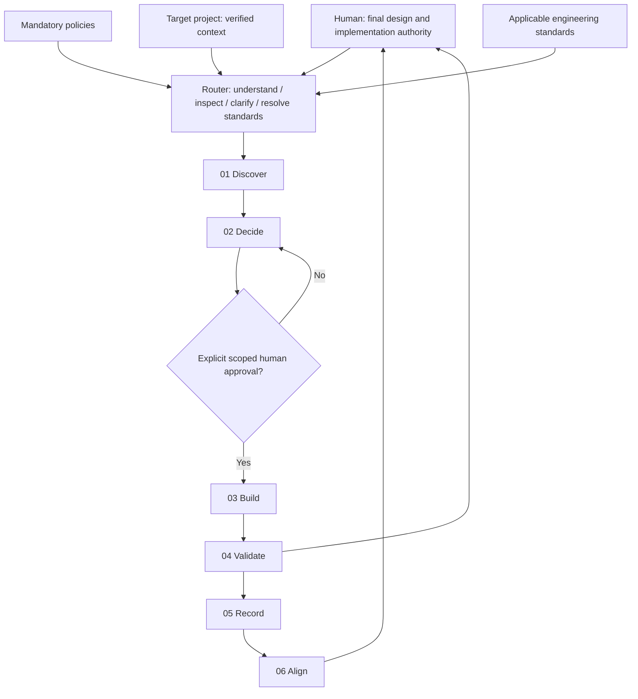

# AI-Ready Project Framework

**Status: Architecture and process design baseline — skill implementation deliberately deferred.**

A reusable, human-governed, standards-driven framework that guides AI coding agents and engineers through discovery, decision-making, implementation, verification and alignment of **new and existing** engineering projects. Data Engineering is its first specialised domain.

> **Human decides. AI investigates, recommends, explains, implements only after explicit approval, and reports evidence.**

## Start here — instructions for an AI adopting this repository

1. Read [AGENTS.md](AGENTS.md) and [human authority policy](policies/human-authority.md) first.
2. Read [the design specification](docs/FRAMEWORK-DESIGN.md) and [routing contract](router/ROUTING-CONTRACT.md).
3. Read [adoption instructions](docs/ADOPTION-PLAYBOOK.md), choosing **brownfield** or **greenfield**.
4. Inspect the target project **read-only** and present verified findings, uncertainties, conflicts and options.
5. **Do not create, migrate, overwrite or refactor anything** until the human explicitly approves a concrete proposal.
6. Apply only relevant engineering standards via [standards index](standards/index.yaml); adapt to the project's approved technology and policies.
7. Treat skill directories as **design placeholders**, not a claim that executable skills are available.

## Architecture

**Six stages** group **nine original capabilities**: Audit, Scope; Architect; Develop; Check, Test; Document; Sync; plus Debug as a cross-cutting capability. The order is a conceptual lifecycle, not an obligation to run every skill for every request.

## Document map

| File | Purpose |
| --- | --- |
| [AGENTS.md](AGENTS.md) | Entry instructions for any AI agent |
| [FRAMEWORK-DESIGN.md](docs/FRAMEWORK-DESIGN.md) | Goals, layers, architecture, workflow and invariants |
| [ADOPTION-PLAYBOOK.md](docs/ADOPTION-PLAYBOOK.md) | Reproduction into existing or new repositories |
| [ROUTING-CONTRACT.md](router/ROUTING-CONTRACT.md) | Intent resolution, gates, stop rules and re-entry |
| [Policies](policies/) | Authority, approval and safe execution |
| [Skills](skills/) | Grouped skill design catalogue; **no executable skill contents yet** |
| [Standards](standards/) | Data Engineering guidance and selective applicability |
| [Example](examples/workday-change.md) | End-to-end non-executing Workday walkthrough |

## Non-goals

- Not a ticket tracker, sprint planner, PR dashboard or change register.
- Not a general-purpose AI memory subsystem or duplicated source of project truth.
- Not a mandate to adopt Databricks, dbt, Airflow, medallion architecture or any one model/vendor.
- Not an autonomous implementation or production-deployment agent.
- Not yet a ready-to-install set of nine working skills.

## Provenance and adaptation

Inspired by JS Mastery's [skills](https://jsmastery.com/skills) and [workflow guides](https://jsmastery.com/workflow-guides#guide-reference), and refined for human-led Data Engineering project work. This repository documents an independent design, not a copy of proprietary skill implementations. Future skills must be implemented, tested and reviewed individually.
