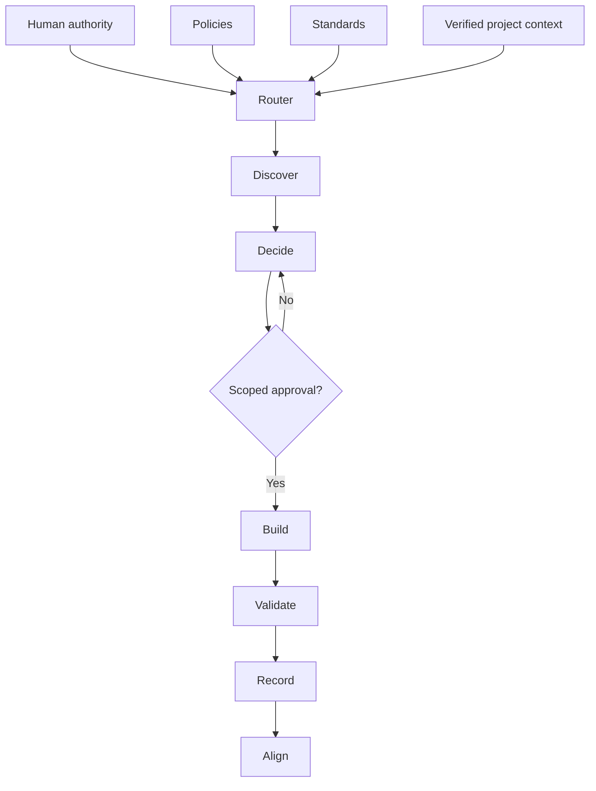
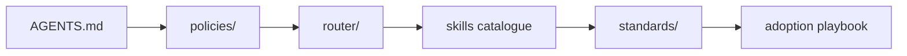

# AI-Ready Project Delivery Framework

**Delivered by:** [Zynx Technologies Ltd](https://www.zynxtechnologies.com/)  
**Portfolio host (pre-fork):** `anoopdk/agentic-project-framework`  
**Domain client (sanitised):** Zynx x Platform Engineering Client  
**Engagement type:** Framework / Methodology Delivery  
**Portfolio version:** `1.0.0-portfolio`

> Inspection note: Client identity is domain-aliased for public portfolio use. This repository is structured for authenticity review of delivery artefacts, architecture, and engagement scope.

## Project overview

The Platform Engineering Client needed a human-governed framework so AI coding agents and engineers follow a consistent Discover -> Decide -> Build -> Validate -> Record -> Align lifecycle with explicit approval gates, especially for data engineering work.

### Solution delivered

Zynx delivered a reusable AI-ready project framework with AGENTS entrypoint, policies, routing contract, staged skill catalogue placeholders, data engineering standards index, and brownfield/greenfield adoption playbooks.

## Engagement levels

| # | Level |
| --- | --- |
| 1 | Process Discovery |
| 2 | Governance & Policy Design |
| 3 | Routing Contract Definition |
| 4 | Standards Pack & Adoption Playbook |

| Field | Value |
| --- | --- |
| Engagement posture | Delivery portfolio artefact prepared for audit / inspection |
| Confidentiality | Domain alias only; no real client legal name in public docs |
| Primary artefacts | Code/notebooks/docs already in-repo + Zynx standard pack under `docs/` and `decks/` |

## Architecture

### Implementation flow

## Technology stack

`Delivery framework`, `Policy gates`, `Routing contracts`, `Engineering standards YAML`, `Adoption playbooks`

## Repository map

| Path | Purpose |
| --- | --- |
| `README.md` | Project overview + engagement levels |
| `docs/` | Problem, solution, architecture, implementation, runbook, audit factsheet |
| `decks/` | 3-slide delivery overview (Markdown + HTML) |
| `src/` / project subtree | Implementation assets (or placeholders where design-led) |
| `tests/` | Tests or placeholders |
| `scripts/` | Operational / helper scripts |
| `configs/` | Non-secret configuration templates |
| `.env.example` | Environment variable placeholders |

### Key existing delivery paths

- `AGENTS.md`
- `docs/FRAMEWORK-DESIGN.md`
- `policies/`
- `router/`
- `standards/`

## How to inspect this repository

1. Read this README (overview + engagement).
2. Open `docs/audit/PROJECT-FACTSHEET.md`.
3. Review architecture in `docs/03-architecture.md`.
4. Walk implementation evidence listed in the factsheet.
5. Open `decks/overview.html` for the 3-slide executive summary.

## Related Zynx context

Zynx Technologies Ltd provides IT consulting across cloud, data analytics, and digital delivery. This repository is part of the public delivery portfolio hosted on `anoopdk` prior to organisation-level fork.

## License

See `LICENSE`.
