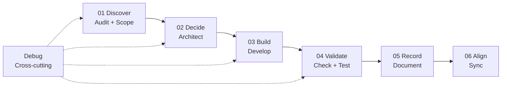
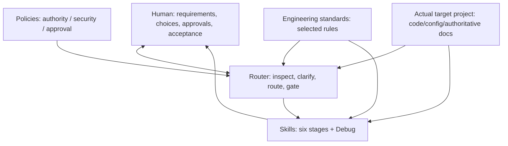
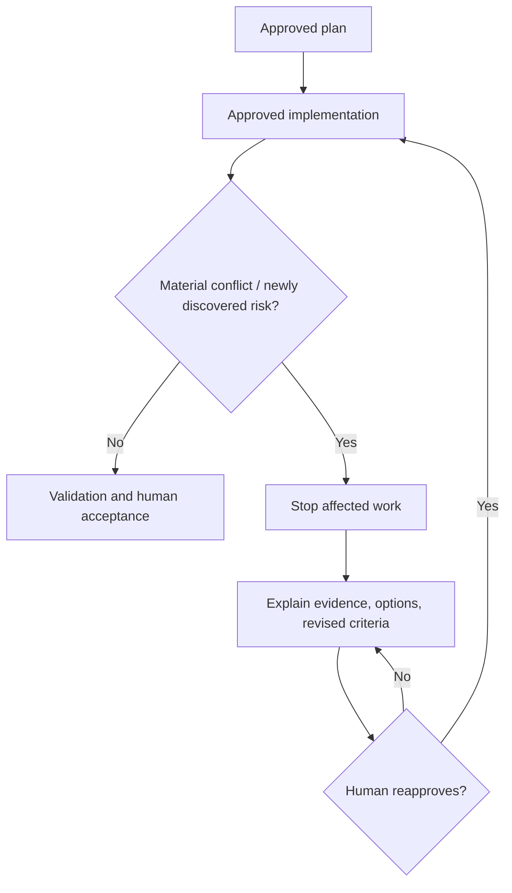

# Design discussion and decision rationale

> **Status: Detailed design record, not operational skill instructions.**
>
> This document captures the substantive discussion behind the framework, including early proposals, challenges, superseded choices and final design direction. Read [AGENTS.md](../AGENTS.md), [FRAMEWORK-DESIGN.md](FRAMEWORK-DESIGN.md) and [ROUTING-CONTRACT.md](../router/ROUTING-CONTRACT.md) for **normative current rules**. An historical proposal below does not override those rules.

## Source references

The initial engineering workflow concept was discussed with reference to:

1. **Video:** [Engineering System for AI Agents](https://www.youtube.com/watch?v=Vok_nReMFaU). User-supplied video link and earlier transcript; the framework draws design inspiration, not a guarantee that the video's methods are production-ready.
2. **JS Mastery Skills:** https://jsmastery.com/skills
3. **JS Mastery Workflow Guides — Guide Reference:** https://jsmastery.com/workflow-guides#guide-reference

These are **external reference material**. They are not the source of authority for this repository's human-approval rules. Their live content and executable implementations have not been independently validated as part of this design baseline. Avoid claiming that content in them is reproduced verbatim here.

## 1. Original objective and pressures

Build an **AI-ready project framework primarily for Data Engineering**, reusable on a completely new project or retrofitted into an existing codebase. An AI directed to this repository should understand the process, inspect its destination, and propose an appropriate installation/adaptation. The intention is to guide engineering behaviour, not proliferate administrative documentation.

Initial questions raised:
- Does the original nine-skill model handle mid-project changes?
- Where should changing scope, architecture, source systems, cluster configuration, AI model preference, or business logic be surfaced?
- Is a `memory/`, `change/` or similar record needed?
- How does the framework ensure multiple engineers/agents work against the project's **actual current design**?
- How are Data Engineering standards applied consistently, not merely mentioned?

Examples included a **HiBob + Ashby → Databricks → dbt Silver/Gold → metric views** people-analytics platform, subsequently encountering: onboarding a new benefits or Workday source; changing Databricks compute; replacing an Opus-class coding model with Haiku for selected work; and revising attrition semantics to exclude internal transfers.

A small-looking change can be business-critical: changing the attrition numerator may restate historical reports. Every such case requires domain-specific impact analysis rather than a generic changelog entry.

## 2. What the original nine capabilities represent

| Capability | Intended activity | Typical outputs in original approach |
| --- | --- | --- |
| Scope | Clarify desired feature and requirements | Scope / priority documents |
| Audit | Identify real conventions and current code | Agent context / audit findings |
| Architect | Compare and specify technical design | Feature / design specifications |
| Develop | Implement agreed solution | Source / configuration |
| Check | Review implementation against requirements | Review observations |
| Test | Add and execute automated verification | Unit/integration/regression tests |
| Document | Describe delivered change | Documentation / PR summary / changelog where appropriate |
| Sync | Detect documentation/context drift | Reconciliation with real system |
| Debug | Identify causes and propose fixes | Diagnosis and eventually approved fixes |

Important observation: **nine skills are not nine mandatory document files**. Their responsibilities are distinct but can share existing project sources of truth. The original ideas provide some scope updates, specs and sync behaviour; this is not an absence of change handling. The gap is structured **change impact, business semantics, human-controlled decisions and Data Engineering-specific verification**.

### Our regrouping



Six lifecycle stages, **nine capabilities total**; Debug stays cross-cutting rather than forced into Align. Each skill can eventually have its own folder with `SKILL.md`, references or tests if needed. Folder grouping is useful but does not itself create reliable routing or enforcement.

**Deferred:** implement the detailed nine skill contents later. Existing directories are placeholders only.

## 3. Steering vs tracking — a decisive refinement

An early proposal introduced seven documentation folders:
`docs/scope/`, `specs/`, `decisions/`, `changes/`, `architecture/`, `contracts/`, `reviews/`, plus possible `memory/` or a separate Change Governance capability.

**Rejected as a mandatory project scaffold:** It creates duplicate truths, drift, unnecessary ceremony and administrative overhead. The user's core distinction: *the framework should steer the project, not track it*.

| Steering (this framework) | Tracking (external systems) |
| --- | --- |
| How requirements are clarified | Who owns a ticket |
| Which options/standards shape design | Sprint / due dates / task status |
| What evidence demonstrates correctness | PR workflow and assignment status |
| How to respond when assumptions change | Chronological change log of all work |
| Which current architecture/context is authoritative | History of commits and merges |

Use Git and existing project tools for change history and execution status. Do **not** add a project-specific task ledger by default. Create a decision specification or data contract **only when useful as authoritative durable engineering information**. No generic memory folder. A session note is not a new source of truth.

### What is the minimal documentation?

The framework repository is a reusable library (skills, router, policies, standards, examples and design). Its adopted **target project** should *not* receive a copy of everything. A practical example might be `README.md`, `AGENTS.md`, `src/`, `tests/`, and only needed scope or architecture docs. Existing repositories should mostly retain their own structure. A lean project could need no new docs except a short agent entrypoint referencing the framework.

Documentation creation test: **unique purpose + clear authority/owner + information not reliably represented elsewhere**. Prefer links to code/config over duplicating cluster settings, grants or deployed values. Avoid mandatory per-change spec and review files.

## 4. Architecture: policies, router, workflow, standards, context

The agreed model adds **foundational policies** above four cooperating architectural components:

1. **Router:** interprets intent, scans context, identifies missing decisions, selects workflows and standards, and enforces human approval checkpoints.
2. **Workflow skills:** execute Discover / Decide / Build / Validate / Record / Align, with Debug across stages.
3. **Standards:** reusable **prescriptive engineering guidance**, not another stage, ticket registry or particular vendor stack.
4. **Project context:** verified facts about requirements, architecture, code, configuration, approved conventions, constraints and known boundaries.



The agent must never make material decisions just because the standards index matched a topic. A standard is guidance about what is acceptable; selecting a consequential option belongs to the human.

### Router vs enforcement

Markdown prompts alone cannot guarantee tool compliance. A practical maturation route is:
- **Initial agent-native form:** instructions, selected standards, review and human sign-off.
- **Later hybrid form:** add deterministic CI/schema/security checks and tool-level write permissions where needed. Adopt only with human approval and validated integration.

This preserves light adoption, while acknowledging limits of prompt-only control.

## 5. Standards: how they should be defined and applied

The **Data Engineering focus** includes at least:
- **Architecture:** layering, boundaries, interoperability and approved patterns.
- **Data ingestion:** API, files, CDC, incremental processing, watermarks, schema drift and backfills.
- **Modelling:** fact grain, business and surrogate keys, relationship cardinality, dimensions, SCD1/SCD2, late-arriving data, business metric semantics.
- **Pipeline design:** orchestration dependencies, idempotency, retries, replay, recovery, SLAs.
- **Data quality and contracts:** schema expectations, uniqueness, freshness, completeness, source-to-target reconciliations.
- **Security and governance:** PII classification, access permissions/grants, row/column security, masking, secrets, ownership and lineage.
- **Testing:** unit, integration, regression, contract and data reconciliation tests.
- **Deployment:** IaC, CI/CD, environment isolation, rollout, rollback and destructive migration safety.
- **Observability and cost:** monitoring, incident signals, lineage, runtime baselines and compute economics.
- **AI development tools (where applicable):** model choices, data handling boundaries, outputs, evaluation and cost/quality trade-offs.

Each future rule should be easy to apply:

| Part | Meaning |
| --- | --- |
| Principle | Why the quality/property matters |
| Default | Recommended standard approach |
| Exception | When an alternative may be valid |
| Applicability | Trigger conditions and consuming skills |
| Verification | How it can be demonstrated or tested |

**Illustrative modelling rule DIM-003:** Declare the grain of every fact table before development; specify business keys and treatment of late arrivals. Raw ingestion tables are exempt from **dimensional fact** requirements. Check reviews grain and join cardinality; Test verifies uniqueness and expected records. Architect, Develop, Check and Test all consume the same rule.

The standards index enables **selective loading**. For a Workday ingestion touching PII and employee dimensions, resolve ingestion, modelling, quality, security, pipeline and test guidance. Do not load every standard for a typo fix; do not trust unconstrained agent recollection to surface the important rules. The current `standards/index.yaml` is a *design index*: linked rulebooks are not yet authored, so agents must not invent their contents.

**Technology-neutral:** Databricks, dbt, Airflow, Delta and medallion layers are examples, not compulsory choices. Specific existing-project standards and safe approved conventions may override generic design preferences; security and human authority cannot be overridden.

## 6. Human authority — the most important final requirement

The user made a binding requirement: **Human is the decision maker, design authority, implementation approver and delivery acceptance authority.** AI is only an investigator, critic, guide, recommendation engine and **approved** implementer.

The agent must **not** turn a single high-level request into immediate construction. The approved interaction is:

1. **Understand** what is asked and establish the intended boundaries.
2. **Inspect** available repository/code/config and standards **read-only**; do not imagine unseen infrastructure.
3. **Clarify** blocking unknowns, dependencies and risks; ask the human (possibly multiple passes).
4. **Evaluate options** with feasibility, pros/cons, complexity, cost, security and recommendation.
5. **Confirm design**: have the human choose significant options, then restate requirements, risks and criteria.
6. **Seek explicit implementation go-ahead** for the exact plan, with named changes and exclusions.
7. **Build** only within that approved boundary, maintaining safe standards.
8. **Validate/review** honestly, including failures, gaps and actual evidence.
9. **Seek human acceptance** and any separate deployment/production authorisation.

```mermaid
sequenceDiagram
    actor Human
    participant Router
    participant Project as Target project (read-only until approved)
    Human->>Router: High-level request
    Router->>Project: Inspect permitted files/config
    Project-->>Router: Verified evidence + missing facts
    Router->>Human: Questions, risks and candidate options
    Human->>Router: Clarifications and selected design
    Router->>Human: Exact implementation contract + acceptance criteria
    Note over Router,Human: Mandatory no-write boundary
    Human->>Router: Explicit approval of current contract
    Router->>Project: Implement only approved modifications
    alt New material issue found
        Router->>Human: Stop affected work; revised options
        Human->>Router: New decision and scoped reapproval
    end
    Router->>Human: Actual test evidence and outstanding issues
    Human->>Router: Accept or request revision
```

The AI must identify **VERIFIED**, **INFERRED** and **UNKNOWN** items. If critical information is unavailable, ask; do not hallucinate. An unverified Workday incremental interface is not a confirmed capability. The agent may recommend an option, but does not silently choose one. A generic “add Workday” authorises investigation/proposal, **not repository writes**.

**Approval efficiency:** not every question needs its own dialogue round and approved within-plan implementation details do not need repeated microapprovals. Consolidate clarifications; nevertheless **a single mandatory pre-write approval cannot be skipped**.

### Scoped approval is not blanket permission

Approval to implement does **not** mean permission to deploy, merge/push where separately controlled, change production access, perform destructive operations, rewrite historical data, or silently choose a different architecture. Those need distinct human authorisation.

A material surprise — changed scope, unsupported deletion semantics, violated security policy, inconsistent identity mapping, new data loss risk, meaningfully changed model selection, or historical restatement — **stops affected work** and returns to design/decision stages. Re-present the revised contract and obtain renewed authorisation.



### Mandatory security boundary

Never hard-code or reproduce passwords, API tokens, private keys, production credentials, connection strings containing secrets, or other sensitive values — including examples, docs, test data, logs or responses.

If a task needs credentials, **pause**, tell the human the required permission or secret reference, and propose approved provision via secure vault, identity-based access or managed secret store. **Do not ask for raw secrets in chat.**

If secrets are found, report their location without printing the value and recommend rotation/remediation. If a human requests hard-coding anyway, refuse **that method** and propose a safe alternative. Do not bypass PII classification, grants, masking, privacy, environment separation or least privilege.

For Databricks, examples include Unity Catalog permission controls and approved secret scopes or identity-based credentials where supported, but no feature is assumed present without inspection.

## 7. Illustrative Workday walkthrough

Request: “Add Workday as a new employee source, ingest incrementally into Databricks, and extend the employee dimension.”

**Prebuild inspection:** Look for existing HiBob/Ashby patterns (if present), orchestration, bronze/silver/gold design, employee dimension grain/SCD type, identity resolution, existing grants, DQ/test suite and downstream metric views. Identify unknown Workday interface capabilities and security permissions.

**Material clarification questions:**
- Which Workday domains (workers, organisation, positions, employment events) and fields?
- What approved Workday interface? Can it actually deliver incremental changes and deletions?
- Which system is authoritative when employee identities or attributes disagree?
- What SCD and history/restatement behaviour is expected?
- What SLA/frequency/retention and PII permissions apply?
- Which downstream metrics and users could be affected?

**Options:** Compare feasible approved source extraction approaches (API/report/snapshot reconciliation where supported); explain reliability, cost, rate limits, completeness, recoverability, backfills and trade-offs. Human picks.

**Implementation contract:** Specify selected ingestion approach and environment, landing/storage and transformation impacts, dimension changes, quality and regression checks, security boundaries, affected documentation, unresolved risks and **no production/deployment approval**.

**Stop condition:** If deletion signals or employee key rules prove inadequate, do not quietly implement a different CDC pipeline. Stop and request revised decision.

**Acceptance:** Real test outcomes: grain/uniqueness, incremental/replay, late corrections, reconciliations, masking/grants, affected metrics. Report what has not been tested; human confirms acceptance.

## 8. Midway change examples — final handling

| Change | Engineering obligations | Where current truth lives |
| --- | --- | --- |
| New data source | Reinspect interfaces, classification, ingestion, modelling, DQ, consumers and costs; human selects approach | Source code, schemas, source contracts and project architecture if needed |
| Databricks cluster/config change | Inspect IaC/approved config, performance, cost, runtime, compatibility, deployment gates | Deployment configuration; rationale only where durable |
| Opus → Haiku | Assess quality/capability, cost, privacy/approved data flow and compatibility; human selects model | Approved AI tooling configuration and guidance |
| Attrition numerator excludes internal transfers | Determine effective definition, historical reprocessing, reporting impact, owners and tests; business owner approves semantics | Governed metric definition, transformation code and relevant tests |
| Minor SQL correction | Inspect/diagnose, compact proposed fix, obtain edit approval, test as appropriate | Code and tests; document only when warranted |

The framework **steers how changed requests are assessed**. Git/issues/PR systems handle tracking and history. No mandatory `/memory` or `/change` ledger. Sync means detect and reconcile **authoritative project context**, not reproduce ticket status. Distinguish *current truth*, *significant decision rationale*, *execution state*, *revision history* and *validation evidence* without giving each its own folder.

## 9. Challenges and anti-overengineering rules

1. **Nine skills ≠ nine files.** A capability may touch files, tests and code; do not force all outputs.
2. **Six folders ≠ architecture.** Router, standards resolution, approval gates and context are the actual operating design.
3. **No automatic new documentation tree.** Minimal, useful docs in destination.
4. **No general memory folder.** Avoid drifting second source of truth.
5. **No standalone change-governance bureaucracy.** Make the workflow change-aware.
6. **No process explosion for trivial changes.** Approval before writes stays; scope of questioning and design review is proportional to risk.
7. **No duplicated production settings in prose.** Reference the authoritative configuration.
8. **No forced vendor stack.** Engineering standards specify outcomes and preferred patterns with justified exceptions.
9. **No implicit confidence as evidence.** Read-only verification, tests, cited files and candid uncertainty.
10. **No conflation of design documentation and runtime guarantees.** Tool permissions and automated gates require later engineering.
11. **No silent design choice by AI.** Human options selection and implementation approval are distinct.
12. **No secret hard-coding even when asked.** Provide safe alternatives.

## 10. Why the design evolved

| Earlier thought | Evaluation | Agreed direction |
| --- | --- | --- |
| Seven or more `docs/` directories | Too many for most adopted projects; drift risk | Lean documents only as needed |
| Add dedicated Change Governance / `changes/` | Steering should not become tracking | Router's change-aware reassessment |
| Add `memory/` | Unstructured second source of truth | Preserve durable facts in existing authoritative locations |
| Put Debug in Align | Debug spans several lifecycle phases | Debug cross-cutting |
| Make every skill read every standard | Wasteful and conflicting context | Selectively resolve applicable standards |
| Let AI begin coding from feature request | Oversteps human design authority | Inspect → clarify → options → contract → explicit approval |
| Rely on prompts for strict safety | Prompt rules alone not technical access control | Initial agent-native guidance; eventual hybrid enforcement |
| Scaffold all skills immediately | Skill design needs careful later review | Nine placeholders, content deliberately deferred |

## 11. Phased maturation

**Baseline (current):** Reusable design architecture, policy documents, router contract, workflow taxonomy, design standards index, adoption guidance and worked example.

**Next — skill design:** Agree detailed content for each of the nine skills: inputs, admissible decisions, standard selection, outputs, failure paths, approval checkpoints and testing.

**Next — engineering standards:** Write and validate each rulebook, with principle/default/exception/applicability/verification; include Data Engineering-specific acceptance tests.

**Next — adoption trials:** Exercise the approach against one real brownfield Data Engineering repository and one greenfield repository; measure unnecessary files, missed risks, approval compliance and ability to reproduce guidance.

**Later — technical enforcement where valuable:** Permission adapters, deterministic checks, CI and vendor-specific integration. Review limitations and seek human agreement before introducing dependencies.

## 12. Instructions for future agents reading this design record

This record exists for **the reasoning and considerations**, not to override the final operating rules. If an early proposal conflicts with a final decision, use the final decision and state the conflict if consequential. **Never assume permission to edit a target repository because this document exists.** Read the normative policy and adoption files and obtain bounded approval.
