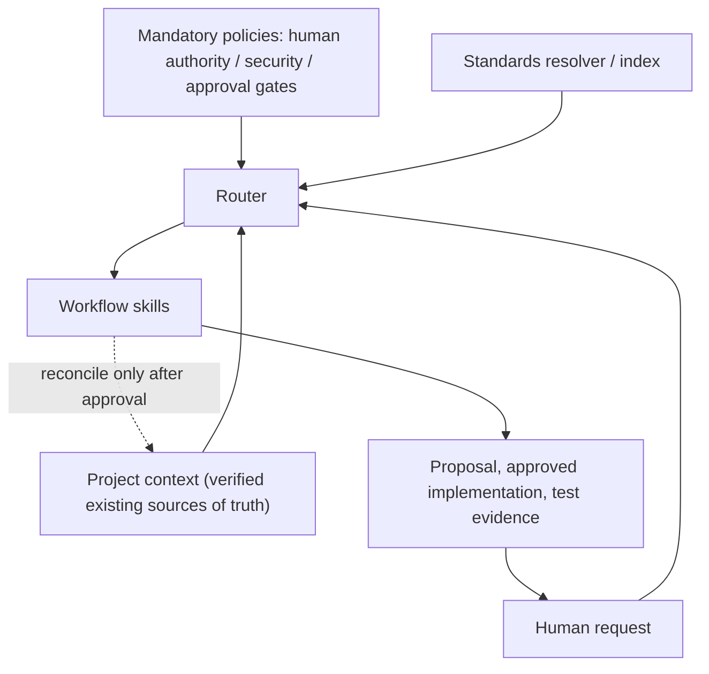
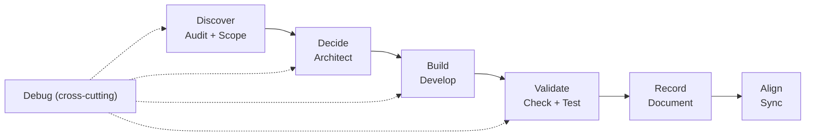
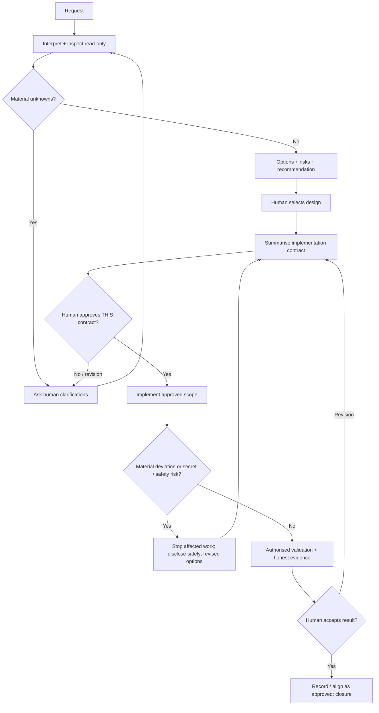
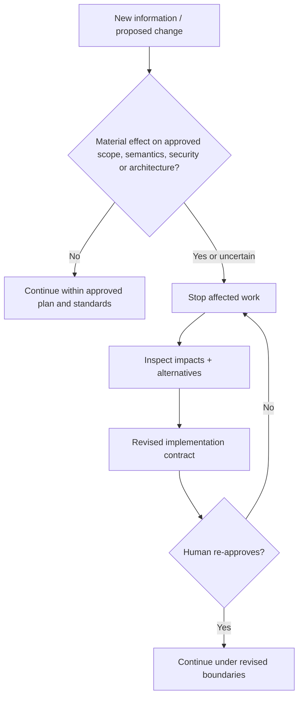
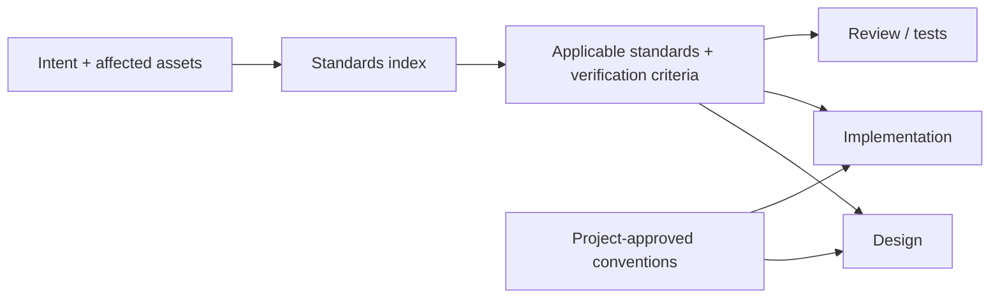

# Framework design and process specification

**Version:** Design baseline 0.1  
**Maturity:** Conceptual design, not implemented or certified  
**Primary domain:** Data Engineering; extensible to other engineering domains

## 1. Purpose and success criteria

Build a transferable way for engineers and AI assistants to **steer** existing or new projects using shared context, explicit decisions, standards, controlled development and evidence-based validation.

Success means an agent can inspect a project and make an accurate, standards-informed, **human-approved** adoption and implementation proposal without imposing a documentation bureaucracy.

Acceptance goals:
- Brownfield onboarding preserves working systems and existing authoritative information.
- Greenfield onboarding recommends a lean minimum, tailored to actual needs.
- Ambiguity produces questions, not invented requirements.
- All writes require explicit human sign-off on a bounded plan.
- Security-sensitive surprises cause a stop.
- Standards guide design, implementation and verification consistently.
- No fictional capabilities, approvals, test results or documentation updates.

## 2. Governing architecture

Four components, with mandatory policies governing all of them:

| Component | Responsibility | Not responsible for |
| --- | --- | --- |
| Router | Intent classification; read-only inspection; standard selection; workflow sequencing; questions and approval gates | Arbitrary autonomous design choices |
| Workflow skills | Discover, decide, build, validate, record, align; cross-cutting debugging | Bypassing router policies |
| Standards | Design principles, preferred approaches, exceptions and verification obligations | Tracking status/tickets |
| Project context | Current authoritative architecture, code, config, business rules and boundaries | Keeping a parallel copy of all project details |

## 3. Six stages and original nine capabilities

| Stage | Original capabilities | Intended outcome |
| --- | --- | --- |
| 01 Discover | Audit + Scope | Verified repository facts, clarified intent and requirements |
| 02 Decide | Architect | Options, trade-offs, recommended design and human choice |
| 03 Build | Develop | Approved implementation only |
| 04 Validate | Check + Test | Review, tests, data-specific acceptance evidence |
| 05 Record | Document | Concise, relevant description of what changed |
| 06 Align | Sync | Bring durable project context into agreement with verified implementation |
| Cross-cutting | Debug | Investigate defects; proposed fixes still require approval |

Stages can be revisited or skipped where justified. **The mandatory pre-write approval cannot be skipped.** Check/Test can propose corrective work; it cannot auto-expand implementation authority.

## 4. Human authority — mandatory interaction pattern

Before changing project files the agent MUST:
1. Understand intent without turning wishes into unapproved technical requirements.
2. Inspect accessible project artifacts **read-only** and identify evidence and uncertainty.
3. Ask material questions and warn about risks, security and downstream effects.
4. Offer feasible design options, recommendations and explicit trade-offs.
5. Resolve material ambiguity through human input, iterating as needed.
6. Present a bounded **implementation contract**: objective, selected option, affected components, exclusions, expected outputs, validation criteria, risks and explicit stop conditions.
7. Stop at **AWAITING_APPROVAL**. Only an unmistakable affirmative response **to the current contract** may enable edits.

After approved edits: perform only approved checks, present evidence, request human acceptance. Deployment, destructive data modifications, access grants and changes to production environments need separate, action-specific authorisation.

## 5. Change-aware steering, not change tracking

Midway changes — new sources, compute changes, model choice changes, attrition semantic changes — trigger **reassessment** of affected assumptions, engineering standards, acceptance criteria and approval scope. Not every change warrants a new document.

- **Current truth**: authoritative source code/config plus existing project documentation.
- **Why a significant choice exists**: update a relevant specification/decision section, only if necessary.
- **What is in progress**: external issue/PR tool, not this framework.
- **History of modifications**: Git, not a duplicate `changes/` ledger.
- **Verification**: test output and existing engineering review mechanisms.

The router must detect when prior context no longer matches changed code and propose reconciliation without silently rewriting approved intent.

## 6. Engineering standards are cross-cutting

Standards define principles, defaults, exceptions, tests and triggers. Examples:
- Fact grain, keys, dimensions, SCD2, late-arriving records.
- Incremental ingestion/CDC, schema drift, idempotency, watermarks.
- Orchestration dependencies, retries, replay, recovery.
- Access grants, least privilege, sensitive data classification, masking, secrets.
- Quality expectations, reconciliation, lineage, deployment and cost.

The router chooses the subset relevant to a request. Skills **must** apply selected standards at design, build and check/test stages. Project-specific approved patterns may override generic recommendations only where safe and within policy.

**Guidance is not enforcement**: instructions cannot guarantee compliance across tools. Later implement deterministic checks or least-privilege tool permissions where requirements justify them; tests/CI and human review remain necessary.

## 7. Decision and information boundaries

The agent **may**: inspect authorised artifacts, identify uncertainty, create comparison options, suggest technical and semantic trade-offs, draft plans, run expressly authorised checks and implement after approval.

The agent **may not**: decide business rules or material architecture unilaterally; infer secrets/permissions; assume production access; push/merge/deploy as a consequence of development approval; silently broaden scope; claim an unverified outcome; bypass security requirements even with human pressure.

A model preference such as Opus vs Haiku is an engineering tooling choice. It can be proposed with evaluation of capability, quality, privacy, cost and permitted data flows, but must not silently change approved models or permitted data handling.

## 8. Lean documentation policy

The framework's own documentation is reusable reference material. Adopting repositories should **not** receive seven empty docs folders or copies of every standard.

Prefer existing README, code, IaC, configuration and project docs. Add `AGENTS.md` as a short entrypoint only when approved. Add `docs/architecture.md`, `docs/scope.md` or specs only when absent, necessary and nonredundant. No default `/memory`, `/changes` or `/reviews` directory. Use links rather than duplicating values/config.

## 9. Tool-neutral adoption

Use `AGENTS.md` as generic entrypoint; optional `CLAUDE.md` or vendor-specific adapter may point to it, not fork policy. Agent skills can later be installed in compatible tool-specific locations as approved. Repository `skills/` is a **design catalogue**, not automatically discoverable by every agent.

## 10. Work explicitly deferred

Detailed skill instructions, CLI wrappers, automated lint rules, compatibility adapters, deployed permission mechanisms, reference implementations, and empirical success measures are *next-phase work*. Their absence must not be concealed. Do not claim that design documents alone provide a technical sandbox or runtime gate.
