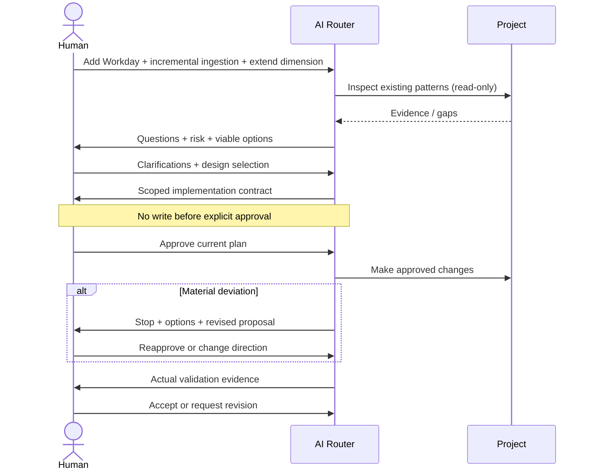

# Worked example — Workday employee source (design-only)

Human: “Add Workday as a new employee source, ingest incrementally into Databricks, and extend the employee dimension.”

**Do not write an ingestion pipeline at this point.** This is a request to investigate and propose.

## Inspect without side effects
- Repository evidence for HiBob/Ashby or other existing source patterns, if present.
- Databricks layering, orchestration, supported ingestion framework and deployment method.
- Employee identity keys, grain, SCD behaviour, metric definitions and consumer dependencies.
- Existing data sensitivity classification, identity/grants, secret handling and data quality.
- Actual Workday integration documents if provided. Do not presume an incremental API, deletion semantics or available credentials.

Separate **verified**, **inferred**, and **unknown**.

## Ask the human
1. Which worker/employment domains and fields are required?
2. Which approved Workday integration interface and permissions are available?
3. Which system is authoritative for employee identity?
4. What are the frequency, history/restatement and deletion/correction requirements?
5. How must PII be masked and which identities may read it?
6. What are acceptance/reconciliation and production rollout boundaries?

## Compare options
Only after knowing interface capabilities, compare available API/report extracts, CDC/event or snapshot-diff techniques **if feasible**, explaining correctness, deletion support, recoverability, rate limits, cost and operational complexity. Recommend one with evidence but **let the human decide**.

## Present contract before any changes
Proposed ingestion entry point, transformations, employee dimension model updates, security measures, tests, backfill behaviour, out-of-scope elements and named target environment. Explicitly ask for approval.

## During approved implementation
If Workday extraction lacks expected deletion signals, or employee keys do not reconcile, **stop** affected development. Do not invent a workaround; explain options and request renewed approval. Never request credentials pasted into code/chat.

## Validation
Report actual unit/integration/DQ outcomes, uniqueness and referential checks, row counts, incremental replay, late corrections and affected metric tests. No claim of tests passing if not run. Request human acceptance. Deployment is separately approved.

