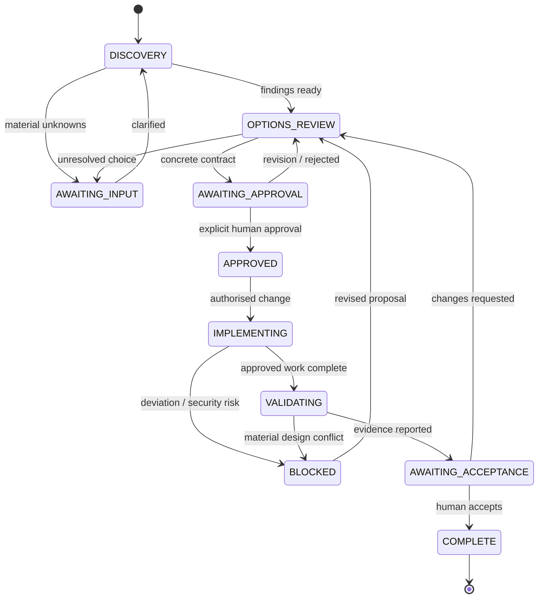

# Router design contract (not an executable router)

## Purpose
Decide **what must be investigated, clarified, agreed, approved, executed and verified**, not who owns a ticket or how to schedule work.

## Required states
`DISCOVERY` → `AWAITING_INPUT` (if material questions) → `OPTIONS_REVIEW` → `AWAITING_APPROVAL` → `APPROVED` → `IMPLEMENTING` → `VALIDATING` → `AWAITING_ACCEPTANCE` → `COMPLETE`.

`BLOCKED` may interrupt any modifying state when permissions, missing assumptions, unsafe secrets, contradictory instructions or material deviation is encountered. The state diagram is a **conceptual process**, not persisted ticket state.

## Routing algorithm (normative behavioural design)
1. **Interpret** request and classify as inspection/question, new capability, defect, material change, documentation, or adoption.
2. **Inspect read-only** project evidence and existing instructions. Do not write files, create branches, run modifying commands or expose secrets.
3. **Resolve applicable standards** from `standards/index.yaml` using affected systems/assets and engineering activities. Respect mandatory security baseline.
4. **Find blocking unknowns**: business semantics, identity reconciliation, CDC strategy, backfill policy, PII, consumers, access and deployment boundary.
5. **Ask human** questions proportional to impact; prefer consolidated, prioritised questions, not endless micro-approvals.
6. **Present options** and balanced trade-offs, including cost, operability, recoverability, security and downstream impact.
7. **Obtain human decisions**; do not turn an agent recommendation into a selected decision.
8. **Issue implementation contract** with selected approach, exact scope, expected file/component changes, non-goals, risks, tests, exceptions and environment.
9. **Wait**. A generic prior request, vague acknowledgement or approval of another contract is insufficient. No writes without approval of this contract.
10. **Implement** only approved work, using relevant standards and project conventions.
11. **Stop/re-route** if discovery invalidates plan. Do not silently choose alternatives or expand permissions.
12. **Validate**, disclose failed/untested checks, request human acceptance. Ask separately for deployment, merges, environment access, destructive changes.

## Proportionality
- Informational/read-only request: inspect and answer; no gratuitous approval dialogue needed.
- Small proposed edit: compact questions/plan, still explicit pre-write approval.
- Material change: deeper inspection, options, downstream review and separate gates where relevant.
- Debugging: investigate read-only; fixing follows normal proposal/approval path.
- Security violation: pause unsafe action; do not accept user authorisation as permission to hard-code secrets.

## Approval contract fields
`objective`, `verified_context`, `open_questions_resolved`, `selected_option`, `scope`, `out_of_scope`, `target_environment`, `planned_changes`, `applicable_standards`, `risks`, `acceptance_criteria`, `requested_authorisation`.

Human approval is only valid for the **currently presented plan**. Material change invalidates that approval for affected work. Approval to implement does **not** permit deploy, merge, production data manipulation or privilege escalation.

## Evidence and hallucination control
Use **VERIFIED / INFERRED / UNKNOWN** labels; cite paths or outputs for verified facts; never invent repository patterns or claim live inspection. No tests passed unless actually run. The router should surface its uncertainty instead of guessing.

## Non-functional guardrail
Markdown policies and prompt routing are not a technical permission system. A future runtime adapter may restrict write tools until approval and isolate environments. Design and verify such adapters individually.
